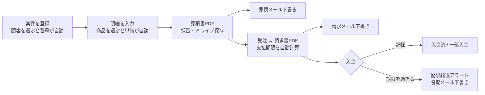

# 見積・請求・入金管理システム（Google スプレッドシート＋Apps Script）

中小企業の「見積 → 請求 → 入金確認 → 督促」を、普段使いの Google スプレッドシートだけで回せるようにした業務自動化システムです。
新しいツールを導入せず、Excel 的な手作業（帳票の手作り・二重入力・入金の目視チェック）をなくすことを狙っています。

> デモ用の会社・顧客・人名・住所はすべて架空です。顧客のメールアドレスは予約ドメイン（`.example`）なので、誤って送っても届きません。

## できること

| 機能 | 内容 |
| --- | --- |
| 顧客マスタ | 会社名・担当者・メール・住所・**支払条件**（月末締め翌月末払い など 6 種） |
| 商品・単価マスタ | 標準単価・単位・税率（10% / 軽減税率 8%） |
| 売上データ入力 | 案件番号と商品を選ぶだけで単位・単価・税率が自動入力。金額・消費税・合計は自動計算 |
| 見積書 PDF | 番号を自動採番（`Q-YYYYMM-001`）し、ワンクリックで PDF 化 |
| 請求書 PDF | 番号を採番（`INV-YYYYMM-001`）、顧客の支払条件から**支払期限を自動計算**。適格請求書（インボイス）の記載事項に対応 |
| Google ドライブ保存 | `見積書／請求書 › 年月` のフォルダに自動整理。再発行時は古い版をゴミ箱へ |
| メール下書き | PDF を添付した Gmail の**下書き**を作成（自動送信はしない） |
| 入金ステータス管理 | 入金を記録すると「未入金 → 一部入金 → 入金済」を自動判定。分割入金にも対応 |
| 未入金アラート | 期限超過を赤表示、開いたときに通知、ダッシュボードに一覧、督促メールの下書きを一括作成、毎朝の自動チェック |
| ダッシュボード | 今月の売上・見積中・未入金残高・期限超過の KPI、月別の売上と入金、顧客別ランキング |
| 操作パネル | サイドバーで選択中の案件の状況確認と、PDF・下書き・入金記録をボタン操作 |
| セルフテスト | 実際のシート上で、数式の計算結果とプログラムの計算が一致するかを 14 項目で自己診断 |

## シート構成

| シート | 役割 |
| --- | --- |
| ダッシュボード | KPI カード・月別グラフ・顧客別ランキング・未入金アラート一覧 |
| 案件・請求 | 1 行 = 1 案件。見積〜請求〜入金状況までを横一列で追える |
| 売上明細 | 案件ごとの明細（商品・数量・単価・税率） |
| 入金記録 | 入金日・請求番号・金額（分割入金は複数行） |
| 顧客マスタ / 商品マスタ | マスタ |
| 設定 | 自社情報・振込先・登録番号・採番の接頭辞・メール件名・アラート設定 |
| 操作ログ | PDF 作成・下書き作成・入金記録・アラートの履歴 |
| 使い方 | 操作手順 |

見出しが濃い紺の列は入力列、やや明るい紺の列は自動計算列です（上書きすると警告）。

## 業務の流れ



## 設計のポイント

- **計算は二重化して検証できる**：シートは数式（`MAP`/`LAMBDA`/`ARRAYFORMULA`）で即時に計算し、PDF に載せる金額は Apps Script 側の純粋関数で計算します。セルフテストが両者の一致を確認します。
- **消費税は税率ごとに 1 回だけ端数処理**（適格請求書のルール）。浮動小数の誤差を避けるため整数で計算します。
- **顧客にメールを自動送信しない**：顧客宛は必ず Gmail の下書き止まり。毎朝のアラート通知も既定はオフで、オンにしても宛先は所有者本人に固定です。
- **業務ロジックは Google のサービスに依存しない純粋関数**（`src/01_Domain.js` など）に分け、Node で単体テストできるようにしています。
- **デモデータは「今日」を基準に直近 12 か月分を生成**するので、いつセットアップしても当月の売上・期限超過・見積中の案件がそろいます。
- 見た目は「古い Excel 帳票」ではなく、枠線を消した帯模様・ステータスのチップ表示・KPI カードの業務システム風に統一しています。

## ファイル構成

```
src/
  00_Config.js     シート・列・設定項目・配色の定義
  01_Domain.js     業務ロジック（期限計算・税計算・ステータス判定・採番）※純粋関数
  02_Render.js     見積書・請求書の HTML（PDF の元）
  03_DemoData.js   架空のデモデータ生成
  10_Sheets.js     シートの読み書き
  20_Setup.js      初期セットアップ（シート・書式・入力規則・数式・ダッシュボード）
  30_Documents.js  PDF 作成・ドライブ保存
  31_Mail.js       Gmail 下書き（見積・請求・督促）
  32_Payments.js   入金記録・未入金アラート・毎朝のチェック
  40_Ui.js         メニュー・自動入力（onEdit）・操作パネル
  50_SelfTest.js   セルフテスト
  Sidebar.html     操作パネル
tests/             Node の単体テスト・模擬スプレッドシートでの通しテスト
scripts/preview.js 帳票の見た目をブラウザで確認
```

## 導入手順

[docs/SETUP.md](docs/SETUP.md) を参照してください（clasp でスプレッドシートごと作成します）。

## テスト

```bash
npm test          # 単体テスト・デモデータの整合性（8 通りの日付）・通しテスト
npm run preview   # 帳票の HTML / PNG / PDF を preview/ に出力
```

実際のスプレッドシートでは、メニュー「請求管理 › 管理 › セルフテストを実行」で動作を確認できます。
